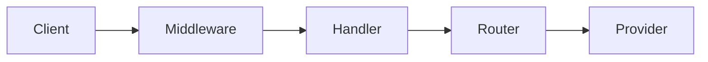

# Architecture

LLM Gate is an HTTP gateway that exposes OpenAI-style `/v1/chat/completions` and `/v1/embeddings` endpoints, routes requests to configured model providers, and applies auth, rate limits, and observability at the edge.

## Components

- **cmd/gateway** — main API process
- **internal/server** — HTTP server wiring and route registration
- **internal/handler** — REST handlers
- **internal/middleware** — cross-cutting concerns (auth, logging, metrics, rate limit)
- **internal/provider** — pluggable backends (mock, Ollama, …)
- **internal/router** — model routing, retries, circuit breaker
- **internal/ratelimit** — token bucket and quota helpers
- **internal/cache** — semantic cache utilities
- **internal/storage** — Postgres and Redis clients

## Request flow

